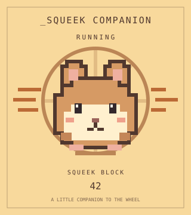
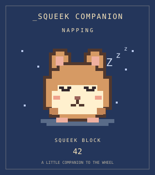
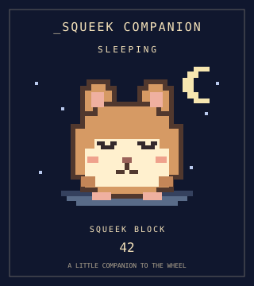

# _Squeek Companion (SQCOM)

An immutable ERC-721 for Ethereum Sepolia (chain ID **11155111**). Each token renders a pixel hamster from SqueekCore's settled wheel activity every time `tokenURI` is read. The JSON and SVG are entirely on-chain. There is no oracle, keeper, companion upkeep transaction, sale, royalty or reward mechanism.

**Deployment status:** implementation and offline deployment rehearsals are delivered here. The collection address and deployment transaction are **pending the separate IMD launch**. This worker has not broadcast a deployment. The launch handoff must supply the confirmed address and transaction link before the Job 2 website goes live. No collection address has been invented.

| Parameter | Fixed value |
| --- | --- |
| Solidity deployment target | `src/SqueekCompanion.sol:SqueekCompanion` |
| Constructor arguments / deployment value | None / zero ETH |
| Name / symbol | `_Squeek Companion` / `SQCOM` |
| Maximum supply | 999, token IDs 1–999 |
| Reserve | 99 tokens, IDs 1–99, minted during construction |
| Reserve recipient | `0x3C7838665Ff8215c95500E1a6306e19E146674a0` |
| Public supply | 900 tokens, IDs 100–999 |
| Mint | `mint()`, nonpayable, one lifetime public claim per caller |
| SqueekCore proxy | `0x74665dAecA35A2303e767E76a2FF1FB6F93e119f` |
| Compiler | Solidity 0.8.26, Cancun, optimizer 200 runs, metadata bytecode hash disabled |

The reserve recipient is a token holder, not an administrator. The factory and transaction sender gain no privileges. There is no owner role, reserve mint function, pause, burn, upgrade, arbitrary call, withdrawal, URI setter or Core-address setter. Standard ERC-721 approvals and transfers remain available. All library functions used by the application are internal, so deployment needs no linked libraries or additional contracts.

## Build and test offline

Foundry and Solidity 0.8.26 must be available. All Solidity dependencies, including their licences, are ordinary files under `lib/`; no install, submodules, RPC or environment configuration is needed for compilation or tests.

```sh
forge build
FOUNDRY_FUZZ_SEED=0x41be4005a735c73b36f76eb18bbb8c20a50e1b78c82d59aa1a02b4ac46d08af2 forge test
forge fmt --check
python3 scripts/export_artifacts.py --check
```

The last command uses Python's standard library and Foundry to check the committed ABI and previews against actual contract output. Omit `--check` to regenerate them. It independently decodes Base64, parses JSON and XML, checks all traits, and verifies that the artwork differs in all three states. It requires neither Foundry filesystem permissions nor FFI.

Tests cover the three activity states, exact 3/12-round boundaries, frontier 0/1/3/4/12/13 and `uint64` limits, sparse and zero-work records, cumulative-work deltas, incomplete/malformed pages, dependency failures, the published ABI's raw return encoding, metadata changes, static mint blocks, ERC-721 transfers/approvals, every public mint through the 999 cap, reserve isolation, invalid receivers and callback reentrancy. Stateful invariant tests mix claims and transfers and check balances, supply, lifetime eligibility, reserve ownership and mint blocks. The default configuration uses 512 runs per fuzz test and 128 invariant runs of depth 64.

## Activity derivation

The integration follows the [SqueekCore v3 reference](https://docs.squeekchain.com/developers/core/) and its [published ABI](https://docs.squeekchain.com/assets/abi/SqueekCore.json). The exact read subset is pinned in [ISqueekCore.sol](src/interfaces/ISqueekCore.sol) and [SqueekCore.reads.json](docs/abi/SqueekCore.reads.json). No call goes to an implementation address.

1. Read `state()` once. Let `F = settledThroughRound`. Calculate Squeek height as `cumulativeBlockUnits / 1_000_000_000`, using integer division.
2. Read `roundPage(max(F - 12, 0), F, 16)` once. Its start is exclusive and its end inclusive. At frontier zero, `(0, 0, 16)` is valid. Twelve rounds fit within one sixteen-record page.
3. V3 checkpoints contain **cumulative** work, not a per-round `work` field. Compare each checkpoint with the previous cumulative-work value, initially `page.start.cumulativeWork`. An increase means positive work in that checkpoint's round.
4. Positive work in `(max(F - 3, 0), F]` means `RUNNING`. Otherwise positive work in `(max(F - 12, 0), F]` means `NAPPING`. Otherwise the state is `SLEEPING`.

For `F = 100`, rounds 98–100 cause `RUNNING`; rounds 89–97 cause `NAPPING` if there is no more recent work; round 88 and earlier are excluded. A large cumulative-work total alone is not recent activity.

The contract rejects incomplete pages, invalid ordering/bounds, decreasing work, or inconsistent cumulative-work endpoints. External call and ABI failures propagate. It never converts an unavailable Core into an apparent sleeping hamster.

The clock is the **certified frontier**, not `block.timestamp`. Unsettled rounds are unknown. If Core stops settling or is paused, the last settled observation remains displayed; it does not age into sleep merely because wall time passes. When Core certifies later zero-work rounds, the state can progress from running to napping to sleeping without any transaction to this collection.

## Metadata and artwork

`tokenURI(id)` checks that the token exists, then returns `data:application/json;base64,...` containing an `image` with `data:image/svg+xml;base64,...`. No HTTP image, IPFS file, font download or renderer service is used. Numeric traits are JSON numbers.

| Trait | Meaning |
| --- | --- |
| `state` | Dynamic `RUNNING`, `NAPPING` or `SLEEPING` |
| `squeek_block` | Dynamic completed Squeek block height |
| `mint_block` | Static **Sepolia Ethereum block.number** at mint; not a Squeek block height |

`mint_block` is deliberately defined in Ethereum blocks, including for the constructor's reserve tokens. It is stored before any receiver callback, never changes on transfer, and does not require Core to be available during deployment or minting. This resolves the brief's unspecified unit for the static trait.

These previews are decoded from the same minted token's `tokenURI` under three mocked histories. All show Squeek block 42 and mint block 20,000,000; they are simulations, not claims about current live activity.

| RUNNING | NAPPING | SLEEPING |
| --- | --- | --- |
|  |  |  |

Decoded [running](docs/previews/running.json), [napping](docs/previews/napping.json) and [sleeping](docs/previews/sleeping.json) JSON are included. Regenerate them with `python3 scripts/export_artifacts.py`.

## Mint and integration behavior

Call `mint()` with zero ETH from the wallet receiving the token; it returns the new token ID and emits the normal ERC-721 `Transfer` event. Users still pay Sepolia transaction gas. `hasMinted(wallet)` tracks public-claim history permanently, independently of `balanceOf`. Transferring a token away does not allow another claim. Receiving transferred tokens does not consume a public claim or impose a holding limit. The reserve recipient may also claim one of the 900 public tokens under exactly the same public rules.

Contract wallets must implement `onERC721Received`. Mint counters, the lifetime claim flag and the mint block are written before that callback. A callback cannot claim again after transferring the first token away. A rejecting receiver rolls back the entire mint and leaves the same ID available to the next successful caller.

Public minting starts at ID 100 and stops at ID 999. The 99 reserved IDs already exist at deployment and cannot be consumed by public claims. The recipient may transfer or approve those reserved NFTs normally after deployment.

The [published collection ABI](docs/abi/SqueekCompanion.json) supports the Job 2 website. Useful reads are:

| Read | Result |
| --- | --- |
| `currentState()` | `(uint8 activity, uint256 squeekBlock, uint64 frontier)`; activity 0=RUNNING, 1=NAPPING, 2=SLEEPING |
| `totalSupply()` / `publicMinted()` | Existing tokens / consumed public allocation |
| `hasMinted(address)` | Whether this address used its public claim |
| `mintBlock(uint256)` | Token's immutable Sepolia mint block; reverts for nonexistent IDs |
| `ownerOf`, `balanceOf`, `tokenURI` | Standard ERC-721 metadata/ownership reads |

There is no ERC-721 Enumerable extension. IDs are contiguous, so the gallery can enumerate 1 through `totalSupply()` or index `Transfer` events. Query related data at one explicit Ethereum block tag for a consistent snapshot. A gallery should refresh metadata after SqueekCore settlement and avoid permanently caching a token URI. There are no companion metadata-update events when Core changes, because the companion sends no transaction. When Core is unavailable, ownership and minting continue to work while live metadata reads fail.

## Deployment handoff and after launch

Deploy **only `SqueekCompanion`**, with no constructor arguments and no ETH, using the repository build settings. The constructor mints the reserve to the hardcoded recipient with `_mint`, intentionally without invoking any receiver hook or reading an outside contract. It works on an otherwise empty chain and does not use the factory or origin as an owner. `ISqueekCore` is an interface and `CompanionArt` is an inlined library, not separate deployment targets.

There are **no after-launch owner settings** and **no companion operational transactions** to keep the art current. Responsibilities remaining with the launch operator are:

1. Confirm Sepolia chain ID 11155111 and recheck the supplied Core proxy's code and v3 read ABI before deployment. The upstream Core is upgradeable even though this NFT is immutable.
2. Deploy the built application, retain the receipt, and publish its confirmed contract address and `https://sepolia.etherscan.io/tx/` transaction link in the launch handoff and this README. These fields remain pending until that transaction exists.
3. Confirm all 99 reserve `Transfer` events point to the named recipient, that IDs 1–99 exist, and that the fresh deployment reports public supply consumed as zero. Check runtime bytecode against the artifact with the same compiler/settings.
4. Verify source on Sepolia Etherscan with the pinned settings, or publish the included ABI with the confirmed collection address. The ABI is already available in this repository; explorer source verification remains a launch task.
5. Simulate `mint()` from a fresh wallet, submit a zero-value mint through that wallet, confirm its receipt, and confirm a second claim reverts. Do not publish keys. Supply the confirmed address/chain/ABI to Job 2.

For read-only inspection after the launch handoff supplies the collection address, set the shell variables `RPC_URL` to a Sepolia RPC URL and `COMPANION` to that confirmed address, then use:

```sh
cast chain-id --rpc-url "$RPC_URL"
cast call "$COMPANION" 'name()(string)' --rpc-url "$RPC_URL"
cast call "$COMPANION" 'symbol()(string)' --rpc-url "$RPC_URL"
cast call "$COMPANION" 'currentState()(uint8,uint256,uint64)' --rpc-url "$RPC_URL"
cast call "$COMPANION" 'totalSupply()(uint256)' --rpc-url "$RPC_URL"
cast call "$COMPANION" 'publicMinted()(uint256)' --rpc-url "$RPC_URL"
cast call "$COMPANION" 'ownerOf(uint256)(address)' 1 --rpc-url "$RPC_URL"
cast call "$COMPANION" 'tokenURI(uint256)(string)' 1 --rpc-url "$RPC_URL"
```

The reserve holder's only responsibility is custody of their NFTs. Core settlement and governance remain Squeekchain's responsibility. Its reporter, pauses and future proxy upgrades affect the observed data and can break an immutable consumer's ABI assumptions. This implementation follows v3; it has no administrative mechanism to switch providers or repair an incompatible upstream upgrade. It observes recorded activity and introduces no mechanism that rewards, directs or requires the hamster's behavior.

Dependency versions and checksums are recorded in [docs/dependencies.json](docs/dependencies.json). See [docs/VALIDATION.md](docs/VALIDATION.md) for the local checks and their limits.
